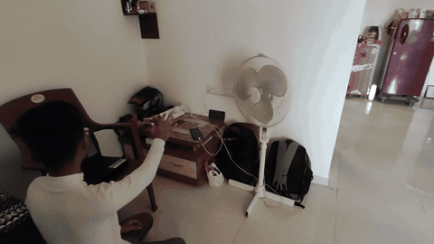

# Gesture Home Automation

Control household appliances with 10 hand gestures. A webcam watches your hand, a gesture model decides which
gesture it is, and a serial command tells an Arduino UNO to flip a relay (bulb, fan, charger) or the buzzer.



Built for **SAP Code Unnati Innovation Marathon 2.0 (2024)**, where the team placed in the **top 25 of 300+ teams**.

## How it works

```
Webcam -> MediaPipe Hands (21 landmarks) -> Keras gesture classifier (10 classes)
       -> class name -> serial command (e.g. PEACE\n) -> Arduino UNO -> relay / buzzer
```

## Gestures

| Gesture | Action | Command |
|---|---|---|
| okay / stop | all ON / all OFF | `OKAY` / `STOP` |
| smile / live long | charger ON / OFF | `SMILE` / `LIVE_LONG` |
| thumbs up / thumbs down | fan ON / OFF | `THUMBS_UP` / `THUMBS_DOWN` |
| peace / call me | bulb ON / OFF | `PEACE` / `CALL_ME` |
| fist / rock | buzzer ON / OFF | `FIST` / `ROCK` |

Details in [docs/gestures.md](docs/gestures.md).

## Hardware

Arduino UNO, 4-channel relay module (3 channels used), active buzzer module, PIR sensor (state is streamed
over serial, not used for switching), jumper wires, a webcam. Wiring: [docs/wiring.md](docs/wiring.md).

## Setup

**Python 3.10 or 3.11** (the pinned TensorFlow/MediaPipe versions do not support newer Python).

```bash
python -m venv .venv && source .venv/bin/activate   # Windows: .venv\Scripts\activate
pip install -r requirements.txt
```

**Arduino:** open `arduino/gesture_home_automation/gesture_home_automation.ino` in the Arduino IDE and upload it
to an UNO. Relays default to OFF on boot (modules are active-LOW).

**Model:** the model files are not included because their licence is unknown. Download the project code from the
[TechVidvan tutorial](https://techvidvan.com/tutorials/hand-gesture-recognition-tensorflow-opencv/) and copy the
`mp_hand_gesture/` folder and `gesture.names` into a folder, e.g. `model/`.

## Run

```bash
# try it with just a webcam, prints the commands instead of using serial
python src/gesture_home_automation.py --model-dir model --dry-run

# with the Arduino
python src/gesture_home_automation.py --model-dir model --port COM10      # or /dev/ttyACM0
```

Options: `--port` (env `SERIAL_PORT`, default `COM10`), `--baud` (9600), `--camera` (0), `--model-dir`. Press `q` to quit.

## Safety

Relays can switch mains voltage, which can kill. Only wire the mains side if you are qualified, with power
unplugged and in an insulated enclosure. Prototype with low-voltage loads.

## History

Started from a finger-counting LED tutorial, then moved to a 10-class gesture model, relays, a buzzer and a PIR.
The competition build also had voice commands and a PyInstaller-packaged Windows app; see [archive/](archive/).
The team deck is [docs/SAP-Code-Unnati-deck.pdf](docs/SAP-Code-Unnati-deck.pdf).

## Credits

- Idea: Aarush Sood's Hackster tutorial, [Control Led with Open-cv python(Hand gestures) and arduino](https://www.hackster.io/as4527/control-led-with-open-cv-python-hand-gestures-and-arduino-93b020).
- Gesture model (`mp_hand_gesture`, `gesture.names`): appears to come from TechVidvan's
  [Real-time Hand Gesture Recognition using TensorFlow & OpenCV](https://techvidvan.com/tutorials/hand-gesture-recognition-tensorflow-opencv/).
- Built as a team of three; this repo is maintained by Anas Vhora.

## Licence

MIT for the code in this repository ([LICENSE](LICENSE)). Third-party model files keep their own terms.
