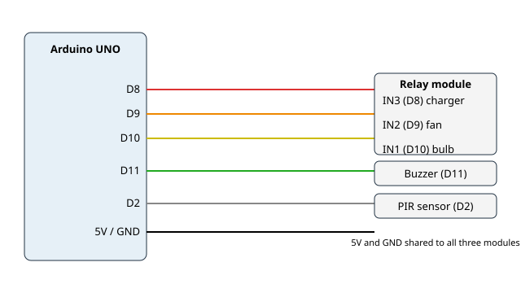

# Wiring

Arduino UNO, 4-channel relay module (3 channels used), buzzer module, PIR sensor.
Both the relay module and the buzzer module are **active-LOW**: the sketch writes `LOW` to switch on.

| Arduino | Goes to | Note |
|---|---|---|
| D10 | Relay IN1 | bulb |
| D9 | Relay IN2 | fan |
| D8 | Relay IN3 | charger |
| D11 | Buzzer signal in | |
| D2 | PIR OUT | state printed on serial |
| 5V | Relay VCC, buzzer VCC, PIR VCC | |
| GND | Relay GND, buzzer GND, PIR GND | |

Appliances connect through each relay's COM and NO terminals (series with the live wire).

**Safety:** relays switch mains voltage. Do the mains side only if you know how, with everything unplugged,
in an insulated enclosure. Test with low-voltage loads (an LED strip on a 12 V supply) first.
